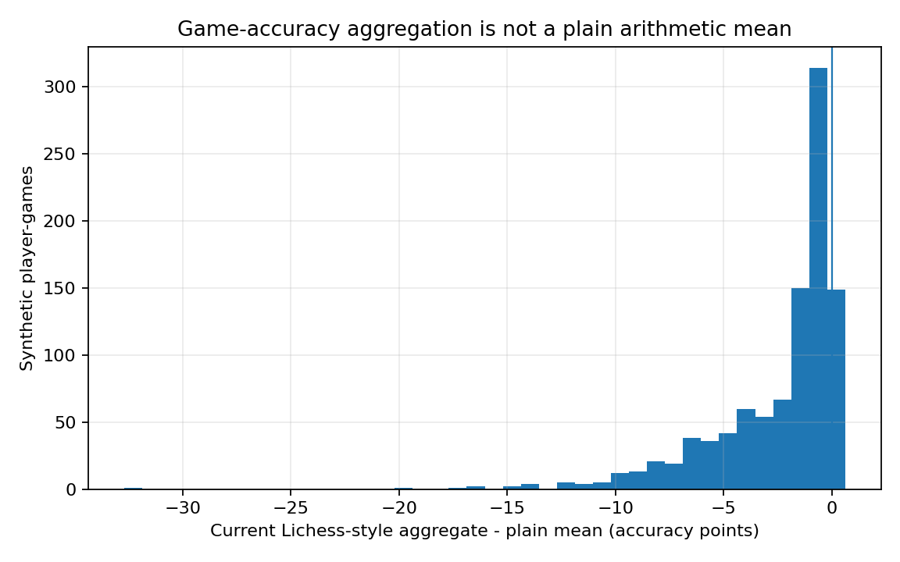

# Chess Evaluation & Model-Audit Laboratory

[](https://github.com/AhmadEblagh205/chess-games-analysis/actions/workflows/ci.yml)


I built this project because I wanted to understand *why* a chess position was being scored, not just receive a number from an engine. It therefore keeps two evaluation layers deliberately separate:

1. a transparent hand-built score using material, piece-square bonuses and mobility; and
2. an optional Stockfish audit when engine strength matters.

The v0.5 audit tightened that separation. A handcrafted evaluator can be useful for explanation while still being a poor judge of tactical move quality. It should not silently inherit the authority of Stockfish, and an engine-derived metric should not be called “Lichess accuracy” unless the aggregation actually matches the published definition.

## What changed in the defensibility audit

The largest correction was in `accuracy.py`. The old code used the Lichess-style *per-move* exponential curve, then reported the **plain arithmetic mean** as the player's game accuracy. Current Lichess game accuracy is not a simple mean: it combines a local-win-volatility-weighted mean with a harmonic mean. V2 ports that aggregation into the dependency-light `accuracy_metrics.py` module and keeps the old arithmetic mean only as an explicit diagnostic.

A 500-world synthetic centipawn-path stress test shows why that distinction matters. Across 1,000 synthetic player-games, the median absolute difference between the current aggregation and a plain mean is **1.24 accuracy points**; the 90th percentile is **6.59 points**, and **54.3%** of cases differ by more than one point. This is a metric-definition experiment, not chess-performance evidence.



The old website/repository headline `Morphy accuracy: 91.7` came from the legacy arithmetic aggregation and should therefore be treated as historical until Stockfish is rerun with the corrected metric.

## Transparent evaluator

The default evaluator is intentionally simple:

- material values in centipawns;
- compact piece-square bonuses;
- a two-centipawn-per-legal-move mobility heuristic;
- checkmate at ±10,000;
- drawn terminal positions at exactly zero.

That last item is another v0.5 fix: the previous implementation only special-cased checkmate, so a stalemate could still inherit a non-zero material score.

```bash
pip install -r requirements.txt
python src/analysis.py
```

`analysis.py` traces hand evaluation and material through each PGN, gives a coarse opening-family label, and flags **hand-evaluation swings**. Those swings are descriptive changes in this model's score, not objective chess mistakes.

The bundled sample contains four public-domain nineteenth-century games: the Immortal Game, the Evergreen Game, Morphy's Opera Game and Paulsen–Morphy.

## Hand evaluation is not calibrated win probability

For visualisation, the repository maps centipawn-like scores through the same logistic transform currently used by Lichess for engine centipawns. That does **not** make the handcrafted score a calibrated probability model: the Lichess transform was derived for engine evaluations, not for this material/placement/mobility heuristic.

V2 uses one mapping consistently everywhere and labels the hand-evaluator probability chart as heuristic rather than reporting dramatic-move probabilities as if they were empirically calibrated.

## PGN annotation without fake certainty

```bash
python src/annotate.py
```

The previous annotator wrote standard `?` and `??` NAG glyphs from the hand evaluator. That was too strong. Tactical sacrifices are precisely where a shallow material-heavy model can fail, so v2 writes:

- `[%eval ...] [hand-eval]` comments; and
- neutral `[hand-swing ...]` diagnostics for large adverse two-ply changes.

It no longer labels those moves as objective “mistakes” or “blunders”. If objective move-quality classification is needed, use the Stockfish path.

## Stockfish audit

```bash
python src/accuracy.py --depth 10
python src/engine.py data/games/immortal_1851.pgn --stockfish /path/to/stockfish
```

`accuracy.py` requires a local Stockfish binary. For each move it converts Stockfish's White-perspective score to the current Lichess win-percentage scale, applies the published move-accuracy curve, and aggregates the game with the current weighted/harmonic definition. It also reports the plain mean separately so the old implementation can be audited rather than silently overwritten.

The v0.5 repository does **not** publish new Stockfish player-accuracy numbers because Stockfish is not available in the audit environment used for this rebuild. The old depth-10 results are preserved under `reports/legacy_v0_4/` and are explicitly historical, not current evidence.

## Why the old “Lichess accuracy” wording changed

The current Lichess implementation uses:

- a centipawn-to-win-percentage logistic transform, capped at ±1,000 cp;
- an exponential move-accuracy curve;
- a game aggregate combining a local-volatility-weighted mean and harmonic mean.

See the public Lichess accuracy explanation and source linked in `docs/METHODOLOGY.md`.

This matters because metric names are claims. Reusing the move formula but changing the aggregation is a related metric, not the same metric.

## Opening labels

For the four bundled games the PGN's ECO code takes priority. A small SAN-prefix fallback remains for user-supplied games. This is deliberately a coarse family label, not a full opening database or transposition-aware classifier.

## Personal-game import

```bash
python src/fetch_lichess.py your_username --max 300
python src/analysis.py --dir data/my_games
```

The Lichess endpoint is public for public games. A single export file can contain many PGNs; v2 iterates every game in the file (v1 silently analysed only the first). Downloaded personal exports are ignored by git.

## Tests

```bash
pytest -q
```

The full suite requires `python-chess`; the optional Stockfish integration test skips when no engine binary is installed. The metric-definition layer is dependency-light and can be tested independently:

```bash
pytest -q tests/test_metrics.py
```

During this audit environment, the pure metric suite passes **8/8**. The full chess-dependent suite could not be executed here because `python-chess` is not installed and outbound package installation is unavailable; CI installs the declared dependency and remains the final runtime check before push.

The expanded suite checks, among other things:

- official win-percentage clipping and move-accuracy bounds;
- current game aggregation versus the old plain mean;
- game-balanced `k` fitting;
- terminal draws scoring zero;
- legal parsing of all bundled PGNs;
- neutral annotation rather than unsupported blunder NAGs;
- ECO-first opening labels;
- optional Stockfish integration.

## Repository structure

```text
src/evaluate.py          transparent hand evaluator
src/analysis.py          PGN trajectories and swing summaries
src/annotate.py          neutral hand-eval PGN annotations
src/accuracy_metrics.py  pure Lichess-style numerical definitions
src/accuracy.py          optional Stockfish game audit
src/metric_audit.py      synthetic aggregation stress test
src/engine.py            per-position Stockfish inspection
src/fetch_lichess.py     public-game downloader
src/winprob.py           shared mapping + game-balanced toy fitter
reports/legacy_v0_4/     historical pre-audit outputs
```

## Licence

MIT, see [LICENSE](LICENSE). The bundled historical games are nineteenth-century games supplied as PGN records.
